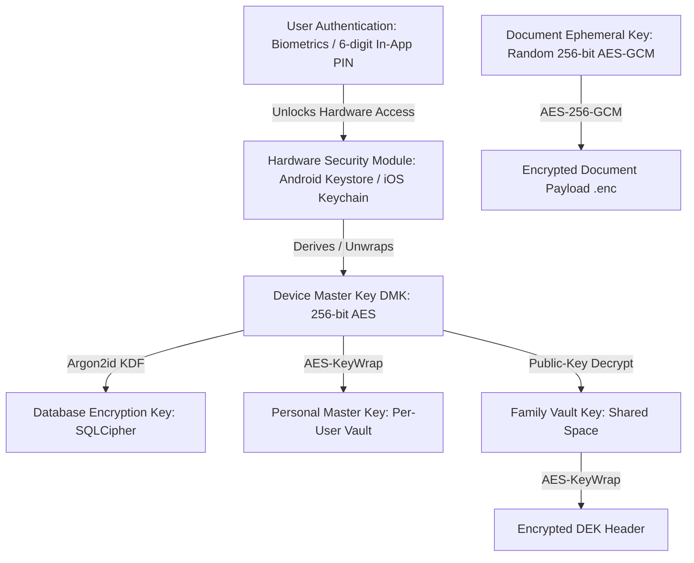

# Family Docs 2.0 — Parallel Architecture & Technical Specifications
**Document Version**: 2.0-Draft  
**Author**: Senior Flutter Architect, Mobile Security Engineer & AI Specialist  
**Status**: Architecture Blueprint for Phase 2 - 5 Implementation  

---

## 1. Security Architecture Specification

### Cryptographic Key Hierarchy
The Family Docs 2.0 cryptographic subsystem operates under a **Zero-Knowledge Envelope Encryption** architecture. No plaintext documents or encryption keys ever leave the device unencrypted.



### 1.1 Key Definitions
1. **Device Master Key (DMK)**:
   - 256-bit cryptographically secure random key (`Random.secure()`).
   - Stored in platform secure hardware:
     - **Android**: `AndroidKeyStore` provider with `MasterKeys.AES256_GCM_SPEC` requiring user biometric authentication (`setUserAuthenticationRequired(true)` with biometric/device credential fallback).
     - **iOS**: iOS Keychain item with accessibility attribute `kSecAttrAccessibleAfterFirstUnlockThisDeviceOnly` and access control `kSecAccessControlBiometryAny | kSecAccessControlDevicePasscode`.
2. **Personal Master Key (PMK)** & **Family Vault Key (FVK)**:
   - Symmetric AES-256 keys. PMK protects a member's private documents; FVK protects documents shared across the entire family.
3. **Data Encryption Key (DEK)**:
   - Generated uniquely for each individual document payload.
   - Algorithm: **AES-256-GCM** with authenticated 128-bit tag and 96-bit unique IV (Initialization Vector).
   - IV is never reused; generated fresh per encryption.

### 1.2 Inactivity & Session Lifecycle Guard
- `WidgetsBindingObserver` monitors app lifecycle states (`AppLifecycleState.paused`, `inactive`, `detached`).
- An inactivity timer (configurable: `Immediately`, `1 minute`, `5 minutes`) resets a volatile session token.
- When backgrounded, a native window protection policy is enforced:
  - **Android**: Sets `WindowManager.LayoutParams.FLAG_SECURE` to prevent screenshots and obscure recent apps task snapshot.
  - **iOS**: Native view overlay blurs screen contents upon transition to inactive.

### 1.3 Key Recovery & Rotation
- **Emergency Recovery Phrase**: Standard BIP-39 12-word mnemonic phrase.
- Key rotation: Re-encrypts DEK headers with new FVK without needing to download and re-encrypt heavy raw file payloads (Lazy Re-encryption).

---

## 2. Google Drive Integration Architecture

### 2.1 Storage Model & Drive API Permissions
Per approved decisions:
- **Do NOT use `drive.appdata` as the shared family document repository** or sole user-controlled backup.
- `drive.appdata` is hidden from the user, lacks family sharing capabilities, and prevents user-visible manual verification.

### 2.2 Dual-Tier Drive Storage Topology

```text
Google Drive Root/
└── Family Docs Safe Vault/               (User-visible folder: 'Family Docs Safe Vault')
    ├── .vault_manifest.enc              (Encrypted JSON catalog + vector clocks)
    ├── personal_vaults/
    │   └── member_rahul/
    │       └── blobs/
    │           ├── doc_uuid_1.enc       (AES-256-GCM encrypted document payload)
    │           └── doc_uuid_2.enc
    └── shared_family_vault/
        ├── .keyshare_manifest.enc       (Encrypted FVK shares for family devices)
        └── blobs/
            ├── doc_uuid_3.enc
            └── doc_uuid_4.enc
```

### 2.3 Drive API OAuth Scopes
- Restricted Scope: `https://www.googleapis.com/auth/drive.file`
  - Grants access **only** to files and folders created or opened by Family Docs 2.0.
  - Does **not** request access to user's entire Google Drive, ensuring minimal privilege and faster Google OAuth app verification.

### 2.4 Synchronization & Conflict Protocol
- **Change Tracking**: Utilizes Google Drive `Changes.list` API with incremental sync tokens.
- **Conflict Handling**:
  - Deterministic Vector Clocks `(device_id, revision_sequence)`.
  - Content conflicts are never destructively overwritten; both versions are retained:
    `{Title} (Conflicted copy from {Member} on {Date}).pdf`.
  - Soft deletes: Deleted documents append a tombstone record with `deleted_at` timestamp.

---

## 3. Database Architecture (SQLite Schema v2)

### 3.1 Comparison: v1 vs. v2

| Aspect | v1 (Current) | v2 (Proposed) |
| :--- | :--- | :--- |
| **Relational Integrity** | No foreign keys, no PRAGMA check | `PRAGMA foreign_keys = ON;`, `ON DELETE CASCADE` |
| **Spaces Partitioning** | None (flat member categories) | `spaces` table separating `personal` vs `shared_family` |
| **Document Paths** | Absolute paths (broken on iOS update) | **Relative paths only** dynamically resolved |
| **File Identification** | Original raw file name (collision risk) | Immutable `uuid` + separate user-facing `title` |
| **Cryptographic Fields** | None (plaintext storage) | `encryption_iv`, `encryption_tag`, `key_version` |
| **AI / Metadata** | None | `doc_type`, `extracted_id_number`, `issue_date`, `expiry_date` |
| **Search Engine** | SQL `LIKE '%query%'` | **SQLite FTS5** full-text search virtual table |
| **Sync Engine** | Dummy `'pending'` string | `cloud_file_id`, `version`, `sync_status`, `deleted_at` |

---

## 4. On-Device AI & Intelligence Architecture

### 4.1 On-Device vs Cloud Strategy
- **Strict Privacy Rule**: No sensitive identity documents (Aadhaar, PAN, Passports, Bank statements) are uploaded to cloud AI without explicit, per-document opt-in consent.
- **On-Device OCR Engine**: `google_mlkit_text_recognition` (Google ML Kit).
  - Runs natively on NNAPI (Android) and CoreML / Metal (iOS).
  - Zero latency, 100% offline, zero cloud bandwidth.

### 4.2 Language Support Evaluation & Tamil Language Assessment
- **Latin Script** (English, Hindi transliteration): Full out-of-the-box support in standard ML Kit on both Android and iOS.
- **Devanagari Script** (Hindi, Marathi, Sanskrit): Supported via `google_mlkit_text_recognition` Devanagari model.
- **Tamil Language Recognition Evaluation**:
  - *Android*: Supported via ML Kit Text Recognition v2 Tamil script package (`com.google.mlkit:text-recognition-tamil:16.0.1`).
  - *iOS*: iOS Vision framework provides native Tamil text recognition in iOS 16+.
  - *Conclusion*: A hybrid adapter approach allows on-device Tamil recognition natively without external cloud dependencies.

### 4.3 Deterministic Rule Engine for Indian Documents
1. **Aadhaar Card**:
   - Matches: Regex `\b[2-9]{1}[0-9]{3}\s[0-9]{4}\s[0-9]{4}\b`.
   - Verification: On-device **Verhoeff Checksum Algorithm** to validate authenticity without cloud ping.
   - Privacy: Automatically masks first 8 digits in UI: `XXXX-XXXX-1234`.
2. **PAN Card**:
   - Matches: Regex `\b[A-Z]{5}[0-9]{4}[A-Z]{1}\b` with Income Tax Department keywords.
3. **Passport**:
   - Matches: Single letter followed by 7 digits + MRZ (Machine Readable Zone) dual-line parsing.
4. **Expiry Date Extraction**:
   - Multi-format regex: `(VALID UPTO|EXPIRY|EXP|DOExp)[\s:]*([0-9]{2}[/-][0-9]{2}[/-][0-9]{4})`.
   - Extracted date is saved to `expiry_date` and registered with `flutter_local_notifications`.

---

## 5. Critical Storage Bugs: Non-Destructive Fix Proposal

### Bug 1: iOS Absolute File Path Invalidation
- **Problem**: Storing absolute paths (`/var/mobile/Containers/Data/Application/<UUID>/Documents/member_1/...`) in SQLite breaks whenever the OS updates the app container UUID.
- **Fix Strategy (Zero Data Loss Migration)**:
  1. Detect existing database records where `file_path` contains `/Documents/` or absolute prefix.
  2. Parse relative sub-path from substring starting at `member_{id}/...`.
  3. Verify physical file exists at `${newAppDir.path}/${relativeSubPath}`.
  4. Update database record to store only `member_{id}/category_{id}/{uuid}.{ext}`.
  5. Provide a runtime resolver: `File getPhysicalFile(String relativePath) => File('${appDir.path}/$relativePath')`.

### Bug 2: Silent File Overwrite on Collision
- **Problem**: When user imports `invoice.pdf` twice, `pickedFile.copy('${saveDir.path}/$fileName')` silently clobbers the first file.
- **Fix Strategy**:
  1. Generate an immutable random UUID for every stored file: `final fileId = const Uuid().v4();`.
  2. Physical file name: `${fileId}.${extension}`.
  3. Database maintains:
     - `file_name`: User-facing original name (e.g., `Passport_Rahul.pdf`).
     - `relative_path`: Physical disk path (e.g., `member_1/category_2/a1b2c3d4-e5f6.pdf`).
  4. Identical filenames can now coexist safely without risk of overwriting.

